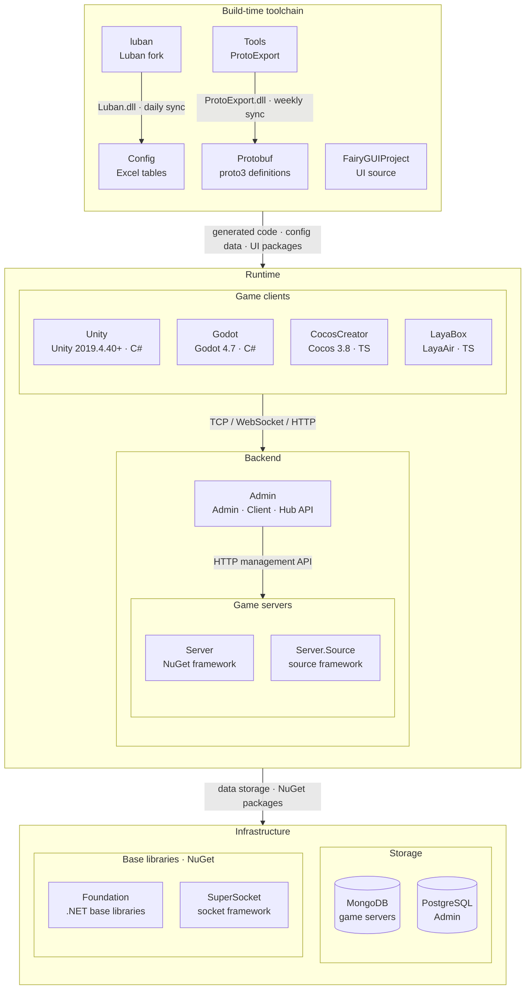

<div align="center">


# GameFrameX Admin

[](LICENSE.md)
[](https://github.com/GameFrameX/Admin/releases)
[](https://gameframex.doc.alianblank.com)

[](https://discord.gg/VDWUjWMDw9)
[](https://github.com/GameFrameX/gameframex)
[](https://www.bilibili.com/video/BV1yrpeepEn7)
[](https://gitee.com/GameFrameX/gameframex)

インディゲーム開発者向けオールインワンソリューション · インディ開発者の夢を支援

<br />

[ドキュメント](https://gameframex.doc.alianblank.com) · [クイックスタート](#クイックスタート) · QQグループ: 467608841 / 233840761
<br />

[English](README.md) | [简体中文](README.zh-CN.md) | [繁體中文](README.zh-TW.md) | **日本語** | [한국어](README.ko.md)

</div>

---

## プロジェクト概要

> 一言でいうと：**インディゲーム開発者向けの運営 + 共同運営管理プラットフォーム**。バックエンドは `.NET 10 + SqlSugar` の 3 ホスト（Admin / Client / Hub）、フロントエンドは `Vue 3 + PrimeVue`。管理者ログインからプレイヤーの決済コールバックまで一本の流れがフルスタックで通っており、すぐに使えます。

**GameFrameX Admin** は**ゲーム運営向け**の管理システムです。管理画面は運営 / GM / カスタマーサポートによるメニュー編集、注文照会、バージョン配信、ログ閲覧を提供します。クライアント API はゲーム側のログイン / 決済 / 設定取得を、Hub API は外部システム（CI ビルド、Tapd WebHook、サードパーティコールバック）を受け持ちます。1 つのリポジトリで 3 つのホストを構成し、DB 分離デプロイで互いに影響しません。

このシステムは汎用 OA / CRM / モールシステムでは**ありません**。メニュー、権限、辞書、フォーム、クライアント設定などは、すべて「ゲーム管理画面」という実際の業務シナリオに沿って設計されています。

本プロジェクトは [Admin.NET](https://gitee.com/zuohuaijun/Admin.NET) をベースに開発しており、Furion フレームワークの残存コードと旧 Admin.NET の業務命名は、すべて置換とベースライン再設定（U5 / U8 / C37–C41）が完了しています。原作者 [zuohuaijun](https://gitee.com/zuohuaijun) とコントリビューターの皆さんに感謝します。

### リポジトリ構成

単一リポジトリ（monorepo）：フロントエンドとバックエンドを同一コードベースで運用します。2026-10-19 より、旧サブリポジトリ `GameFrameX.Admin.Unified.Api` / `GameFrameX.Admin.Unified.Vue` は読み取り専用で凍結され、スナップショットとして本リポジトリへ統合済みです。新規コードはすべて本リポジトリに反映します。

```
Admin/
├── GameFrameX.Admin.Unified.Api/    # .NET バックエンド：Admin / Client / Hub の 3 ホスト + Application / Entity / Core レイヤー
├── GameFrameX.Admin.Unified.Vue/    # Vue フロントエンド：PrimeVue + Pinia + vue-i18n（5 言語）
├── build/                           # Nginx 設定 + デプロイスクリプト（deploy-*.sh / docker-build-push.sh / entrypoint.sh）
├── doc/                             # README 用画像
├── .github/workflows/               # CI：3 API イメージとフロントエンドイメージのビルド、フロントエンドテスト、外部イメージ同期
├── docker-compose.yml               # コマンド 1 つのフルスタック編成（PostgreSQL + 3 API + フロントエンド）
├── .env.example                     # compose 環境変数テンプレート（.env にコピーして必要に応じて上書き）
├── AGENTS.md / CLAUDE.md            # AI エージェント連携入口（ルート指示 + readme_i18n 設定）
└── LICENSE.md                       # ライセンス
```

## クイックスタート

> **新しいゲーム**に運営管理画面を導入するシーンを想定しています。このセクションを読み終えれば、0 からログインまで進み、TeamS admin でメニューツリーを確認できるようになります。

### 準備

- .NET 10 SDK
- Node.js ≥ 20（推奨 20）+ pnpm ≥ 11.5.2（`corepack enable`）
- データベースがなくても OK。ローカルでソースを直接実行すればデフォルトで SQLite のゼロ設定。本番では PostgreSQL / MySQL など 34 種の DbType に対応

### 手順

```bash
# 1. コードを取得（単一リポジトリ、フロントエンドとバックエンドを同梱）
git clone https://github.com/GameFrameX/Admin.git
cd Admin

# 2. バックエンドを起動（リポジトリルートで実行！ 接続文字列はワーキングディレクトリ相対で解決されます）
dotnet run --project GameFrameX.Admin.Unified.Api/GameFrameX.Web.Api     # Admin API → http://localhost:20802
dotnet run --project GameFrameX.Admin.Unified.Api/GameFrameX.Client.Api  # Client API → http://localhost:20808
dotnet run --project GameFrameX.Admin.Unified.Api/GameFrameX.Hub.Api     # Hub API → http://localhost:20806

# 3. フロントエンドを起動
cd GameFrameX.Admin.Unified.Vue
corepack enable
pnpm install
pnpm run dev    # デフォルト http://localhost:20800（hash ルーティング）
```

ブラウザを開く → ログインページが表示される → アカウント `admin` / パスワード `123456` / テナント `1300000000001`（初回起動時に SqlSugar Code-First が自動でテーブル作成 + シードデータ投入を行います）。

### コマンド 1 つでフルスタック（リポジトリルートの統一 compose）

```bash
docker compose up -d --build
```

Compose には PostgreSQL + 3 つのホスト（20802/20806/20808）+ Admin フロントエンド（20800、`pnpm run dev` と排他。コンテナを起動する前に先に dev server を停止してください）が組み込まれており、起動後 healthcheck が緑になればアクセスできます。

環境変数の統一エントリ：ルートの [`.env.example`](.env.example) を `.env` にコピーして必要に応じて上書きしてください（未設定の変数は compose のデフォルト値を使用。`.env` は git 管理対象外です）。

より細かいコマンドと落とし穴については [`GameFrameX.Admin.Unified.Api/README.ja.md`](GameFrameX.Admin.Unified.Api/README.ja.md)（バックエンドマニュアル）と [`GameFrameX.Admin.Unified.Vue/README.ja.md`](GameFrameX.Admin.Unified.Vue/README.ja.md)（フロントエンドマニュアル）を参照してください。

## 向いているケース / 向いていないケース

| 向いている | あまり向いていない |
|---|---|
| インディ / 小規模チームのゲームで、動く運営管理画面が必要 | すでに完全な管理画面があり、その中の一部のモジュールだけ欲しい |
| 複数の接続先（管理 / クライアント / 外部システム）で明確な境界が必要 | 単一用途のシンプルな管理画面（Admin.NET / vue-next-admin を直接使う方が軽量） |
| マルチテナント SaaS 化したゲームサービス | 単一テナントの自社運営で外部公開の予定がない |
| .NET + SqlSugar の技術スタックが必須 | チームが Java / Go / Node しか経験していない |
| 多言語（5 言語 i18n）+ AI Agent フレンドリーなリポジトリが必要 | — |
| マイクロサービスへ進化できるモノリスとして始めたい | — |

## 技術スタック

- **バックエンド**：.NET 10 + ASP.NET Core ネイティブホスティング + SqlSugar（Code-First、34 種の DbType）+ JWT/HMAC + SignalR + Serilog。
- **フロントエンド**：Vue 3.5 + Vite 6 + TypeScript strict + PrimeVue 4.5 + Pinia 3 + vue-i18n（5 言語）+ Axios。

選定リストの全容とバージョンマトリクスは [バックエンド README · 技術スタック](GameFrameX.Admin.Unified.Api/README.ja.md#技術スタック) と [フロントエンド README · 技術スタック](GameFrameX.Admin.Unified.Vue/README.ja.md#技術スタック) を参照してください。

## 3 つのホスト：Admin / Client / Hub

1 つのリポジトリで 3 つのホスト、DB 分離デプロイで互いに干渉しません：**Admin API**（20802、管理画面）、**Client API**（20808、ゲームクライアントのログイン/決済/設定）、**Hub API**（20806、外部システム / CI / WebHook）。三者は Entity と SqlSugar リポジトリを共有し、依存の向きは下方向のみです（`Application.*` / `Core.*` からホストへの逆参照は厳禁）。

### 3 ホストの最大の違い

| 観点 | Admin API | Client API | Hub API |
|---|---|---|---|
| ルーティング | 動的 API（Service を書くと自動的に API が生える） | 動的 API | 従来型 Controller（`[Route("api/[controller]/[action]")]`） |
| データアクセス | Application Service 経由 → リポジトリ | Application Service 経由 → リポジトリ | Controller に `Repository<T>` を直接注入 |
| Application 層の再利用 | する | する | しない（自前でバリデーション） |
| 新規 API の追加 | Service を書く | Service を書く | Controller を作成 + リポジトリを注入 |
| URL 規則 | `Service` 接尾辞を除去 + camelCase | `Service` 接尾辞を除去 + camelCase | `Controller` 名 + `Action` 名 |
| SuperAdmin を拒否するか | しない（SuperAdmin は全フィルタをバイパス） | しない | **する**。Hub は SuperAdmin のアクセスを拒否 |

> **URL に `Service` 接尾辞を含めることは厳禁**。新人が 100% 踏む落とし穴です。フロントエンドはこの規約に基づいて呼び出しコードを生成するため、クラス名が変わるとフロントが全面的に壊れます。

## マルチテナント + アプリケーションスコープ

3 層モデル、外側から内側へ：

```
SuperAdmin（プラットフォーム級）── グローバル設定・テナント横断クエリが可能
    ↓
Tenant テナント（マルチテナント SaaS 化）── アプリ横断で共有
    ↓
App アプリ（テナント配下の個別ゲーム / 製品）── AppId スコープ
```

| Scope | 意味 | ルーティング例 |
|---|---|---|
| `platform` | プラットフォーム級（SuperAdmin のみ表示、テナント横断） | `/platform/*` |
| `tenant` | テナント級（すべてのアプリで共通、appId query なし） | `/dashboard/*`、`/system/*` |
| `app` | アプリワークベンチ内（`appId` query が必須） | `/gameCenter/*` |

マルチテナントとデータベースの境界はエンティティ属性で自動的に有効になります：`[Tenant]` は `TenantId` フィルタ + ソフトデリートを自動付与、`[SystemTable]` はメイン DB へ、`[LogTable]` はログ DB へルーティング、属性なしは JWT の `TenantId` でルーティングします。詳細は [バックエンド README · リポジトリとマルチデータベースルーティング](GameFrameX.Admin.Unified.Api/README.ja.md#リポジトリとマルチデータベースルーティング) を参照してください。

## 30 の機能モジュール

「実際に使うシーン」別のグループ分けであり、ディレクトリ構造順ではありません。

**認証と権限**

| モジュール | 内容 |
|---|---|
| ユーザー管理 | テナントユーザー / システム管理者の管理。ユーザーに役職・組織・ロール・データ権限をバインド可能 |
| 組織管理 | 多階層ツリー型の組織構造 |
| 職位管理 | ユーザーの役職タグ |
| メニュー管理 | ディレクトリ / メニュー / ボタンの 3 段階権限 |
| ロール管理 | ロールへのメニュー + データ権限範囲のバインド |
| 辞書管理 | グローバル / テナントの 2 階層辞書 |
| オープン認証 | AccessKey / Secret + HMAC 署名認証（外部 API） |

**プラットフォーム設定（SuperAdmin のみ表示）**

| モジュール | 内容 |
|---|---|
| プラットフォームテナント管理 | テナント CRUD、テナント DB の自動開設 / 停止 / 有効期限 |
| グローバルプラットフォーム / 言語 / チャネル定義 | プラットフォーム級の列挙型と多言語ベースライン |
| 地域管理 | 行政区画の 5 階層ツリー、統計局からの同期に対応 |
| システム設定 | キー・バリュー。高頻度の設定はメイン DB の `SystemConfig` に移管（JWT / パスワードポリシー / 画像 CAPTCHA） |
| データベース管理 | テーブル / カラム CRUD、DB スキーマのオンライン管理 |

**システム機能**

| モジュール | 内容 |
|---|---|
| サービス監視 | ホスト情報、CPU / メモリ / ディスク / ロード済みアセンブリ |
| オンラインユーザー | リアルタイム一覧 + 強制ログオフ、SignalR ベース |
| お知らせ管理 | システム通知 + SignalR リアルタイム配信 |
| ファイル管理 | ローカルストレージ + アリババクラウド OSS + Tencent COS（マルチプロバイダ） |
| 定時タスク | `ProjectScheduler` プロジェクト独自スケジューラ。内蔵 / スクリプトコンパイル / HTTP の 3 種。実行時 C# コンパイルによる動的 API |
| メール / SMS | `Mail.Abstract` マルチプロバイダ + `Sms.Abstract` の Aliyun 実装 |
| システム API | Swashbuckle Swagger。本番ではデフォルトで無効（`Swagger__Enabled=true` が必要） |
| 4 種ログ | 操作 / 例外 / アクセス / データ変更（フィールド単位の Diff 監査）、Excel エクスポート対応 |
| 実行時プラグイン | C# コードを動的コンパイルして API エンドポイントとして登録 |
| キャッシュ管理 | Memory / Redis の統一抽象 |

**ゲーム運営機能（76 の Application.Game サービス）**

| モジュール | 内容 |
|---|---|
| ゲームアカウント / キャラクター / ゲームサーバ | プレイヤーアカウント、キャラクター管理、Docker コンテナのライフサイクル |
| 注文 / アイテム配布 | 多軸フィルタリング。HTTP でゲームサーバ API を呼び出してアイテムを付与 |
| メール / 引換コード | 全サーバ / 単一サーバメール。引換コードのチャネルと投入 |
| Web ショップ | 商品 + 注文 + カテゴリ |
| アイテム / 商品 | アイテムカタログ、消耗品 / 永久品の管理 |
| お知らせ / バナー | ゲーム内 + ログイン後のお知らせ |
| アプリバージョン / リソースパック | アプリバージョン + 強制アップデート + リソースパックのバージョンと履歴ロールバック |
| アプリスコープ設定 | リモートパラメータ、アプリ検証、クライアント KV |
| メール運用 | テンプレート + Campaign + 多言語 |
| 広告コールバック | TopOn / AdMob / UnityAds のマルチプロバイダ |
| ゲームサーバ連携 | プレイヤー登録 / ログイン / 注文コールバック |

**外部連携**

| 連携 | 説明 |
|---|---|
| WeChat | `Wechat.Abstract` + `Wechat.Open` の 2 SDK。公式アカウント OAuth2、ミニプログラムログイン、テンプレートメッセージ、JS-SDK |
| WeChat Pay | JSAPI 注文（直結 / サービスプロバイダ）+ 決済コールバック（`Payment.Wechat`） |
| 決済 | Alipay / Apple IAP（App Store Server API v2 含む）/ Google Play / Xsolla。抽象レイヤー + マルチプロバイダ |
| オブジェクトストレージ | Local / Tencent COS（マルチプロバイダ） |
| SMS | Aliyun SMS プロバイダ |
| メール | Tencent SES / SMTP（マルチプロバイダ） |

**フロントエンドフレームワークの特徴**

- **バックエンド駆動メニュー**：メニュー、権限、文言はすべてバックエンドで制御します。フロント側にメニューは書かず、追加はバックエンドのメニュー管理で行います。フロントはバックエンドが返すメニューツリーの描画だけを担当します。
- **JWT 自動更新**：ログインで受け取った token の期限切れ前に自動で `X-Authorization` を付与し、バックエンドが黙って再発行します。一度ログインすれば長期間そのまま使えます。
- **アプリケーションスコープ**：ルートの `meta.appScope` + `meta.menuContext` で platform / tenant / app の 3 スコープを指定し、フロントはスコープに応じてメニューの表示を判定します。
- **i18n 完全性ゲート**：`pnpm run lint:i18n` が 5 言語のキー完全性をチェックします。1 つでも欠ければ即 fail です。

## セキュリティベースライン

「推奨」ではなく、**デフォルトで有効になる**強い制約です。

| 脅威 | 対策 |
|---|---|
| 弱いパスワード | プロジェクト全体で **Argon2id** に統一（C214 システムユーザー / C215 プレイヤー）。旧 PBKDF2 は `AppSecretHasher` のみ保持（高エントロピー乱数キーのユースケースで、Argon2id は不要） |
| SQL インジェクション | SqlSugar の完全パラメータ化。文字列連結なし |
| 権限超過アクセス | マルチテナントフィルタ + ソフトデリートフィルタ。SuperAdmin はバイパスするが Hub API は SuperAdmin を拒否 |
| リプレイ攻撃 | HMAC 署名 + nonce キャッシュ + 5 分の時刻ずれ許容 |
| 情報漏えい | Response DTO には必ず Id/RowVersion/CreatedTime を含める。機密フィールド（パスワードハッシュ / AccessSecret）のあらゆる Response への出現は**禁止**。契約テストで担保 |
| API 変更の回帰 | `ThreeHostApiRoutingContractTests` + `AdminEndpointReturnContractTests` + `AdminActionStyleContractTests` + `NamingAbbreviationGuardTests` で回帰を防止 |

## データベース

**デフォルトはゼロ設定**：ローカルでソースを直接実行する場合はデフォルトで SQLite（リポジトリルートの `db/` 配下）。本番では PostgreSQL（MySQL / Oracle など合計 34 種の DbType もサポート）。`GameFrameX.Application/Configuration/Database.json` が接続文字列の唯一の情報源です（3 ホストで共有、1 箇所変更すれば 3 ホストに反映）。

- メイン DB / テナント DB / ログ DB はエンティティ属性で自動ルーティング（前述のマルチテナント節を参照）。
- テナント DB の自動作成：テナント ID に応じて `gameframex_admin_tenant_<TenantId>` を生成。接続文字列の手入力は不要。デフォルトテナント DB も同様に自動推論されます。
- DB 切り替え時の接続文字列の書き方は [`Database-ConnectionStrings.md`](GameFrameX.Admin.Unified.Api/GameFrameX.Application/Configuration/Database-ConnectionStrings.md) を参照。環境変数のペアオーバーライド（`GFX_MAIN_DB_TYPE` + `GFX_MAIN_DB_CONNECTION_STRING`）などのデプロイ詳細は [バックエンド README · データベース](GameFrameX.Admin.Unified.Api/README.ja.md#データベースデフォルトはゼロ設定本番は-postgresql) を参照してください。

> SQLite はローカル開発専用です。本番での使用は禁止。並行書き込みが弱く、独立したサービスプロセスがなく、バックアップ・復旧や運用監視の能力が不足しているためです。

## デモと始め方

| リソース | リンク |
|---|---|
| デモサイト（**自分の本番環境には使わないでください**） | <https://game.admin.web.vue.alianblank.com> |
| ドキュメントサイト | <https://gameframex.doc.alianblank.com> |
| バックエンド運用マニュアル | [`GameFrameX.Admin.Unified.Api/README.ja.md`](GameFrameX.Admin.Unified.Api/README.ja.md) |
| フロントエンド運用マニュアル | [`GameFrameX.Admin.Unified.Vue/README.ja.md`](GameFrameX.Admin.Unified.Vue/README.ja.md) |

## プロジェクトリポジトリ

| プロジェクト | 用途 | リポジトリ |
|---|---|---|
| 本リポジトリ | Admin / Client / Hub の 3 ホスト単一リポジトリ（Cron 化） | [GameFrameX/Admin](https://github.com/GameFrameX/Admin) |
| クライアント API（独立リポジトリ） | 早期の分割。現在は本リポジトリに統合 | [GameFrameX.Admin.Client.Api](https://github.com/GameFrameX/GameFrameX.Admin.Client.Api) |
| 管理画面 API（有償ソースコード） | 旧命名 | [GameFrameX.Admin.Web.Api](https://github.com/GameFrameX/GameFrameX.Admin.Web.Api) |
| 管理画面 Web（有償ソースコード） | 旧命名 | [GameFrameX.Admin.Web.Vue](https://github.com/AlianBlank/GameFrameX.Admin.Web.Vue) |

## リリースとデプロイ

```bash
docker compose up -d --build
# PostgreSQL + Admin(20802) + Client(20808) + Hub(20806) + フロントエンド(20800) を内蔵。起動後 healthcheck が緑になるまで待つ（フロントコンテナと dev server が 20800 を取り合うため排他）
```

単一コンテナの `docker run`、環境変数のペアオーバーライド（片側だけのオーバーライドは起動時に即エラー）などの詳細は [バックエンド README · デプロイ](GameFrameX.Admin.Unified.Api/README.ja.md#デプロイ) を参照してください。

## 開発とコントリビューション

新しい CRUD サービスを追加したいですか？[`GameFrameX.Admin.Unified.Api/README.ja.md` → 新しい CRUD サービスを追加](GameFrameX.Admin.Unified.Api/README.ja.md) を参照してください。Admin API は `IDynamicApiController` を実装するだけで REST エンドポイントが自動で揃います（Page / Add / Update / Get / List / Delete の 6 つ）。Controller を手書きする必要はありません。

CI ゲート（回帰防止）：

- `ThreeHostApiRoutingContractTests` — 3 ホストのルーティング / HTTP 動詞 / パラメータバインディング / エラーコードの意味領域
- `AdminEndpointReturnContractTests` — Response DTO 契約
- `AdminActionStyleContractTests` — Admin action の記法規約
- `NamingAbbreviationGuardTests` + `NamingAbbreviationBaseline.baseline.txt` — システム全体で業務略語を禁止

## 機能プレビュー

### プラットフォーム管理（SuperAdmin）


### アプリワークベンチのコア機能（中国語・英語対照）

テナントのアプリワークベンチに入ってからの 5 つのコア機能ページ。同じページが中国語 / 英語のインターフェース言語でどう表示されるか（右上の言語スイッチャーでリアルタイムに切替、リロード不要）：

| 機能 | 簡体中文 | English |
|------|----------|---------|
| リモート設定 |  |  |
| バージョン更新 |  |  |
| パッケージ管理 |  |  |
| 決済設定 |  |  |
| 広告コールバック検証 |  |  |

## エコシステム構成

GameFrameX は以下のリポジトリで構成されます。ビルド時のツールチェーンがプロトコルと設定のコードを生成し、実行時はゲームクライアント・ゲームサーバー・運営バックエンドが連携します。



### コアプロジェクト

| プロジェクト | 役割 | 技術スタック | 成果物と連携 |
|------|------|------|------|
| [Unity](https://github.com/GameFrameX/GameFrameX.Unity) | Unity クライアントプロジェクト：GameFrameX UPM レジストリから 90+ のフレームワークパッケージを必要に応じて導入、HybridCLR によるホットアップデート、ログイン・バッグ・ルームのサンプル付き | Unity 2019.4.40+, HybridCLR, YooAsset, FairyGUI, UniTask | Protobuf / Config / FairyGUIProject の成果物を利用；TCP 29100 + HTTP 28080 で Server、HTTP 20808 で Admin Client API に接続 |
| [Server](https://github.com/GameFrameX/GameFrameX.Server) | Actor モデルのゲームサーバー：永続化状態の Apps 層とホットアップデート可能な Hotfix ロジック層を厳密に分離、単一／マルチプロセス構成に対応 | .NET 10, MongoDB, Docker | TCP 29100 / WebSocket 29110 / HTTP 28080 で待ち受け；Admin 向けにメール・アイテム付与・プレイヤー管理などの HTTP 管理 API を提供 |
| [Admin](https://github.com/GameFrameX/GameFrameX.Admin) | マルチテナント運営バックエンド：Admin（20802）/ Client（20808）/ Hub（20806）の 3 ホスト + Vue 管理画面。サーバー区、お知らせ、メール、注文・決済、リモート設定、ライブ運営をカバー | .NET 10, SqlSugar, PostgreSQL, Vue 3.5, PrimeVue | サーバー区ごとの `HttpManageUrl` で Server を呼び出し；Client API がゲームクライアントにグローバル情報・ログイン・決済コールバックを提供 |
| [luban](https://github.com/GameFrameX/luban) | Luban 設定ツールの GameFrameX フォーク：公式 v5.1.0 をマージし、`gameframex` テーブルインポーターと `cs-dotnet-json` / `cs-dotnet-bin` などの生成ターゲットを追加 | .NET 10, Scriban | Luban の tar.gz と Docker イメージを公開；毎日 Config の `Tools/` に同期 |
| [Config](https://github.com/GameFrameX/GameFrameX.Config) | 設定テーブルリポジトリ：Excel データ表 + スキーマ + ローカライズ表。スクリプト一つでクライアント・サーバーのコードとデータを生成 | Excel, Luban | `gen-client-*` → Unity; `gen-server-json` → Server; `gen-server-bin` → Server.Source; `gen-godot-json` / `gen-cocos-json` / `gen-laya-json` → Godot / CocosCreator / LayaBox |
| [Protobuf](https://github.com/GameFrameX/GameFrameX.Protobuf) | 統一ネットワークプロトコル定義：proto3。ファイル名の数値モジュール ID ごとにメッセージとエラーコードを整理（正数＝クライアント↔サーバー、負数＝サーバー内部） | proto3 | `Proto2CsExport_Server` → Server; `Proto2CsExport_Client` → Unity; `Proto2CsExport_Godot` / `Proto2TsExport_CocosCreator` / `Proto2TsExport_LayaBox` → 他のクライアント；push ごとに CI が 6 言語の Release を公開 |
| [Tools](https://github.com/GameFrameX/GameFrameX.Tools) | ProtoExport プロトコルコード生成ツール：C# / TypeScript / C++ / Lua / Go の 5 言語、CLI・Avalonia GUI・Docker の 3 形態 | .NET 10, Avalonia 12 | `ProtoExport.dll` を毎週 Protobuf の `Tools/` に同期；Docker イメージ `gameframex/gameframex-tools` |

### 周辺システム

| プロジェクト | 役割 | 技術スタック | 成果物と連携 |
|------|------|------|------|
| [Foundation](https://github.com/GameFrameX/GameFrameX.Foundation) | モジュール化された .NET ライブラリ群：ローカライズ、JSON、コマンドライン引数、ログ、HTTP、暗号化、ハッシュ、ORM 基底エンティティ、冪等性 | .NET | NuGet パッケージとして Server・Server.Source・Admin・Tools が参照 |
| [SuperSocket](https://github.com/GameFrameX/GameFrameX.SuperSocket) | SuperSocket の GameFrameX フォーク：.NET 10 ターゲット、依存性注入、弱いネットワーク向け KCP / ReliableSession | .NET 10 | NuGet：Server（ClientEngine）、Server.Source（Server / Kcp / Udp / WebSocket） |
| [Server.Source](https://github.com/GameFrameX/GameFrameX.Server.Source) | フレームワーク層をリポジトリ内ソースとして持つサーバー版：サービスディスカバリ、プロセス間 RemoteMessaging（TCP / KCP）、マルチプロセス構成 | .NET 10, MongoDB, Docker | Config `gen-server-bin` の出力先；`docker-compose.multi.yml` でマルチプロセス起動 |
| [Godot](https://github.com/GameFrameX/GameFrameX.Godot) | Godot .NET クライアント：再利用可能なランタイムモジュール、エディタープラグイン、ホットアップデートアセンブリ | Godot 4.7, C# | Config `gen-godot-json`, Protobuf `Proto2CsExport_Godot`；TCP 29100 / WebSocket 29110 で Server に接続 |
| [CocosCreator](https://github.com/GameFrameX/GameFrameX.CocosCreator) | Unity 版をベースに移植した Cocos Creator クライアント | Cocos Creator 3.8, TypeScript | `npm run gen:proto` / `gen:config` が Protobuf / Config のスクリプトを呼び出し；WebSocket で Server に接続 |
| [LayaBox](https://github.com/GameFrameX/GameFrameX.LayaBox) | LayaBox クライアント | LayaAir, TypeScript | Config `gen-laya-json`, Protobuf `Proto2TsExport_LayaBox`；WebSocket で Server に接続 |
| [FairyGUIProject](https://github.com/GameFrameX/GameFrameX.FairyGUIProject) | FairyGUI エディタープロジェクト：全ゲーム UI のデザインソース | FairyGUI Editor | UI パッケージを Unity `Assets/Bundles/UI`、コードを `Assets/Hotfix/UI/FairyGUI/` に出力 |

## ドキュメントとリソース

- プロジェクトドキュメントサイト：<https://gameframex.doc.alianblank.com>
- バックエンド運用マニュアル（詳細）：[`GameFrameX.Admin.Unified.Api/README.ja.md`](GameFrameX.Admin.Unified.Api/README.ja.md)
- フロントエンド運用マニュアル（詳細）：[`GameFrameX.Admin.Unified.Vue/README.ja.md`](GameFrameX.Admin.Unified.Vue/README.ja.md)
- Issue フィードバック：[GitHub Issues](https://github.com/GameFrameX/Admin/issues)
- クライアント / 管理画面 / Web の 3 リポジトリ：[プロジェクトリポジトリ](#プロジェクトリポジトリ) を参照

## コミュニティとサポート

[](https://github.com/GameFrameX/gameframex)
[](https://discord.gg/VDWUjWMDw9)
[](https://www.linkedin.com/in/alianblank)
[](https://www.reddit.com/r/GameFrameX/)
[](https://x.com/alian_blank)
[](https://www.youtube.com/channel/UCD9QhSFJ5xZkn5NTSV-DVAw)
[](https://bsky.app/profile/alianblank.bsky.social)
[](https://www.bilibili.com/video/BV1yrpeepEn7)
[](https://gitee.com/GameFrameX/gameframex)


## 変更履歴

リリース記録は [GitHub Releases](https://github.com/GameFrameX/Admin/releases) をご覧ください。

## ライセンス

詳しくは [LICENSE.md](LICENSE.md) をご参照ください。

<!--
EN: See [LICENSE.md](LICENSE.md) for license information.
zh-CN: 详见 [LICENSE.md](LICENSE.md) 文件。
zh-TW: 詳見 [LICENSE.md](LICENSE.md) 檔案。
ja: 詳しくは [LICENSE.md](LICENSE.md) をご参照ください。
ko: 자세한 내용은 [LICENSE.md](LICENSE.md) 파일을 참조하세요.
-->
