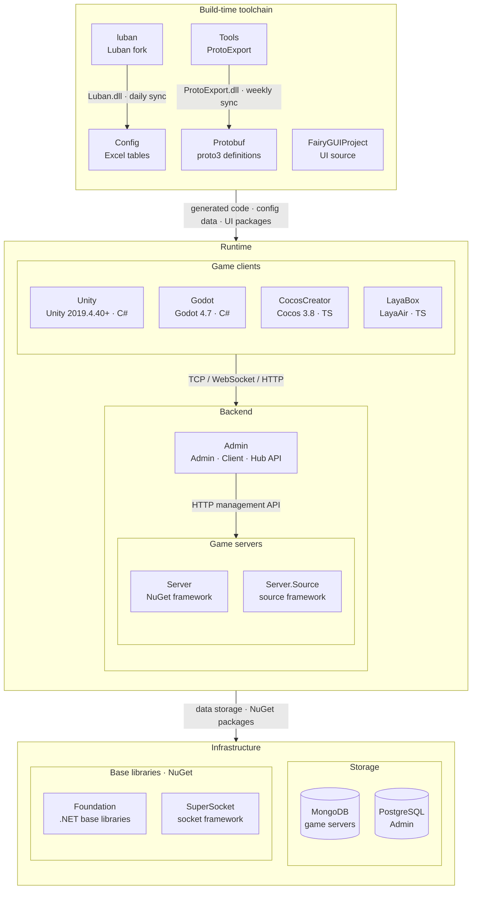

<div align="center">


# GameFrameX Admin

[](LICENSE.md)
[](https://github.com/GameFrameX/Admin/releases)
[](https://gameframex.doc.alianblank.com)

[](https://discord.gg/VDWUjWMDw9)
[](https://github.com/GameFrameX/gameframex)
[](https://www.bilibili.com/video/BV1yrpeepEn7)
[](https://gitee.com/GameFrameX/gameframex)

인디 게임 개발자를 위한 올인원 솔루션 · 인디 개발자의 꿈을 실현

<br />

[문서](https://gameframex.doc.alianblank.com) · [빠른 시작](#빠른-시작) · QQ 그룹: 467608841 / 233840761
<br />

[English](README.md) | [简体中文](README.zh-CN.md) | [繁體中文](README.zh-TW.md) | [日本語](README.ja.md) | **한국어**

</div>

---

## 프로젝트 개요

> 한 줄 정의: **인디 게임 개발자를 위한 운영 + 퍼블리싱 백오피스 플랫폼**. 백엔드는 `.NET 10 + SqlSugar` 기반 3개 호스트(Admin / Client / Hub), 프론트엔드는 `Vue 3 + PrimeVue`. 관리자 로그인부터 플레이어 결제 콜백까지 한 번의 흐름으로 풀스택 구동, 바로 사용 가능합니다.

**GameFrameX Admin**은 **게임 운영 지향** 백오피스 시스템입니다: 관리 화면은 운영 / GM / 고객지원 담당자가 메뉴를 수정하고, 주문을 조회하고, 버전을 푸시하고, 로그를 확인할 수 있게 합니다. 클라이언트 API는 게임 클라이언트의 로그인 / 결제 / 설정 조회를 담당하고, Hub API는 외부 시스템(CI 빌드, Tapd WebHook, 서드파티 콜백)을 위한 것입니다. 하나의 저장소에 세 개의 호스트가 있으며, 데이터베이스를 분리해 배포하므로 서로 간섭하지 않습니다.

이 프로젝트는 **범용 OA / CRM / 쇼핑몰 시스템이 아닙니다**. 메뉴, 권한, 사전, 폼, 클라이언트 설정 등은 모두 "게임 백오피스"라는 실제 비즈니스 시나리오를 중심으로 설계되었습니다.

본 프로젝트는 [Admin.NET](https://gitee.com/zuohuaijun/Admin.NET)을 기반으로 2차 개발되었으며, Furion 프레임워크 잔여물과 원본 Admin.NET 비즈니스 명명은 모두 교체 및 리베이스 완료했습니다(U5 / U8 / C37–C41). 원 저자 [zuohuaijun](https://gitee.com/zuohuaijun)과 기여자분들께 감사드립니다.

### 리포지토리 구조

단일 리포지토리(monorepo): 프론트엔드와 백엔드가 하나의 코드베이스입니다. 2026-10-19부터 기존 서브 리포지토리 `GameFrameX.Admin.Unified.Api` / `GameFrameX.Admin.Unified.Vue`는 읽기 전용으로 동결되어 스냅샷 형태로 본 리포지토리에 병합되었으며, 새 코드는 모두 이곳에 반영됩니다.

```
Admin/
├── GameFrameX.Admin.Unified.Api/    # .NET 백엔드: Admin / Client / Hub 3개 호스트 + Application / Entity / Core 레이어
├── GameFrameX.Admin.Unified.Vue/    # Vue 프론트엔드: PrimeVue + Pinia + vue-i18n(5개 언어)
├── build/                           # Nginx 설정 + 배포 스크립트(deploy-*.sh / docker-build-push.sh / entrypoint.sh)
├── doc/                             # README 이미지
├── .github/workflows/               # CI: 3개 API 이미지와 프론트엔드 이미지 빌드, 프론트엔드 테스트, 외부 이미지 동기화
├── docker-compose.yml               # 한 줄 명령 풀스택 오케스트레이션(PostgreSQL + 3 API + 프론트엔드)
├── .env.example                     # compose 환경 변수 템플릿(.env로 복사한 뒤 필요에 따라 재정의)
├── AGENTS.md / CLAUDE.md            # AI Agent 협업 진입점(루트 지침 + readme_i18n 설정)
└── LICENSE.md                       # 라이선스
```

## 빠른 시작

> **새 게임**에 운영 백오피스를 붙이는 상황을 가정합니다. 이 섹션을 끝내면 0에서 시작해 로그인까지, TeamS admin으로 메뉴 트리를 볼 수 있습니다.

### 준비

- .NET 10 SDK
- Node.js ≥ 20(20 권장) + pnpm ≥ 11.5.2(`corepack enable`)
- 데이터베이스가 없어도 됩니다——로컬에서 소스 직접 실행 시 기본적으로 SQLite 무설정; 프로덕션에서는 PostgreSQL / MySQL 등 34종 DbType 지원

### 단계

```bash
# 1. 코드 받기(단일 리포지토리, 프론트엔드와 백엔드 포함)
git clone https://github.com/GameFrameX/Admin.git
cd Admin

# 2. 백엔드 시작 (저장소 루트에서 실행! 연결 문자열은 작업 디렉터리 기준으로 해석됩니다)
dotnet run --project GameFrameX.Admin.Unified.Api/GameFrameX.Web.Api     # Admin API → http://localhost:20802
dotnet run --project GameFrameX.Admin.Unified.Api/GameFrameX.Client.Api  # Client API → http://localhost:20808
dotnet run --project GameFrameX.Admin.Unified.Api/GameFrameX.Hub.Api     # Hub API → http://localhost:20806

# 3. 프론트엔드 시작
cd GameFrameX.Admin.Unified.Vue
corepack enable
pnpm install
pnpm run dev    # 기본 http://localhost:20800 (hash 라우팅)
```

브라우저를 열면 → 로그인 페이지가 보이고 → 계정 `admin` / 비밀번호 `123456` / 테넌트 `1300000000001`(최초 기동 시 SqlSugar Code-First가 자동으로 테이블 생성 + 시드 데이터 적재).

### 명령 한 줄 풀스택 (저장소 루트 통합 compose)

```bash
docker compose up -d --build
```

Compose에는 PostgreSQL + 세 개의 host(20802/20806/20808) + Admin 프론트엔드(20800, `pnpm run dev`와 상호배타적이므로 컨테이너 기동 전에 dev server를 먼저 중지)가 내장되어 있으며, 기동 후 healthcheck가 초록색이 되면 접속할 수 있습니다.

환경 변수 통합 입구: 루트의 [`.env.example`](.env.example)을 `.env`로 복사한 뒤 필요에 따라 재정의하세요(설정하지 않은 변수는 compose 기본값을 사용하며 `.env`는 git에 포함되지 않습니다).

더 자세한 명령과 주의점은 [`GameFrameX.Admin.Unified.Api/README.ko.md`](GameFrameX.Admin.Unified.Api/README.ko.md)(백엔드 매뉴얼)와 [`GameFrameX.Admin.Unified.Vue/README.ko.md`](GameFrameX.Admin.Unified.Vue/README.ko.md)(프론트엔드 매뉴얼)를 참조하세요.

## 이 프로젝트가 맞는 경우 / 맞지 않는 경우

| 맞는 경우 | 별로 맞지 않는 경우 |
|---|---|
| 인디 / 소규모 팀 게임으로, 돌아가는 운영 백오피스가 필요한 경우 | 이미 완성된 백오피스가 있어 일부 모듈만 원하는 경우 |
| 다중 단(관리 / 클라이언트 / 외부 시스템)의 명확한 경계가 필요한 경우 | 단일 단순 백오피스(Admin.NET / vue-next-admin을 직접 쓰는 게 더 가벼움) |
| 멀티테넌트 SaaS화 게임 서비스 | 단일 테넌트 자체 운영, 외부 공개 계획 없음 |
| .NET + SqlSugar 기술 스택이 필수인 경우 | 팀이 Java / Go / Node만 익숙한 경우 |
| 다국어(5개 언어 i18n) + AI Agent 친화적 저장소가 필요한 경우 | — |
| 마이크로서비스로 발전시킬 수 있는 모놀리식 시작점을 원하는 경우 | — |

## 기술 스택

- **백엔드**: .NET 10 + ASP.NET Core 네이티브 호스트 + SqlSugar(Code-First, 34종 DbType) + JWT/HMAC + SignalR + Serilog.
- **프론트엔드**: Vue 3.5 + Vite 6 + TypeScript strict + PrimeVue 4.5 + Pinia 3 + vue-i18n(5개 언어) + Axios.

전체 선택 목록과 버전 매트릭스는 [백엔드 README · 기술 스택](GameFrameX.Admin.Unified.Api/README.ko.md#기술-스택)과 [프론트엔드 README · 기술 스택](GameFrameX.Admin.Unified.Vue/README.ko.md#기술-스택)을 참조하세요.

## 세 개의 호스트: Admin / Client / Hub

하나의 저장소에 세 개의 호스트가 있으며, 데이터베이스를 분리해 배포하므로 서로 간섭하지 않습니다: **Admin API**(20802, 관리 백오피스), **Client API**(20808, 게임 클라이언트 로그인/결제/설정), **Hub API**(20806, 외부 시스템 / CI / WebHook). 셋은 Entity와 SqlSugar 리포지토리를 공유하며, 의존성은 아래 방향으로만 흐릅니다(`Application.*` / `Core.*`는 호스트를 역참조해서는 안 됨).

### 세 호스트의 가장 큰 차이

| 구분 | Admin API | Client API | Hub API |
|---|---|---|---|
| 라우팅 | 동적 API(Service를 작성하면 자동으로 인터페이스 생성) | 동적 API | 전통적 Controller(`[Route("api/[controller]/[action]")]`) |
| 데이터 접근 | Application Service 경유 → 리포지토리 | Application Service 경유 → 리포지토리 | Controller에 `Repository<T>` 직접 주입 |
| Application 레이어 재사용 | 예 | 예 | 아니요(자체 검증) |
| 신규 인터페이스 추가 | Service 작성 | Service 작성 | Controller 생성 + 리포지토리 주입 |
| URL 규칙 | `Service` 접미사 제거 + camelCase | `Service` 접미사 제거 + camelCase | `Controller` 이름 + `Action` 이름 |
| SuperAdmin 거부 여부 | 아니요(SuperAdmin은 모든 필터를 우회) | 아니요 | **예**——Hub는 초급 관리자 접근 거부 |

> **URL에 `Service` 접미사가 절대 나와서는 안 됩니다**. 신규 입문자가 100% 밟는 함정입니다——프론트엔드는 이 규약에 따라 호출을 생성하므로, 클래스 이름이 바뀌면 프론트엔드 전체가 망가집니다.

## 멀티테넌트 + 앱 스코프

3계층 모델, 바깥에서 안으로:

```
SuperAdmin(플랫폼급)── 전역 설정 접근, 테넌트 간 조회 가능
    ↓
Tenant 테넌트(멀티테넌트 SaaS화)── 앱 간 공유
    ↓
App 앱(테넌트 하위의 개별 게임 / 제품)── AppId 스코프
```

| Scope | 의미 | 라우팅 예시 |
|---|---|---|
| `platform` | 플랫폼급(초급 관리자만 보임, 테넌트 간) | `/platform/*` |
| `tenant` | 테넌트급(모든 앱 공통, appId query 없음) | `/dashboard/*`, `/system/*` |
| `app` | 앱 작업공간 내(appId query 필수) | `/gameCenter/*` |

멀티테넌트와 데이터베이스 경계는 엔티티 특성으로 자동 적용됩니다: `[Tenant]`는 자동으로 `TenantId` 필터 + 소프트 삭제를 추가하고, `[SystemTable]`은 메인 DB로, `[LogTable]`은 로그 DB로 라우팅하며, 표시 없는 것은 JWT `TenantId` 기준으로 라우팅됩니다. 자세한 내용은 [백엔드 README · 리포지토리와 다중 데이터베이스 라우팅](GameFrameX.Admin.Unified.Api/README.ko.md#리포지토리와-다중-데이터베이스-라우팅)을 참조하세요.

## 30개 기능 모듈

"실제로 쓰게 될 시나리오" 기준으로 묶었습니다, 디렉터리 구조 기준이 아닙니다.

**신원과 권한**

| 모듈 | 기능 |
|---|---|
| 사용자 관리 | 테넌트 사용자 / 시스템 관리자 관리, 사용자 직무·조직·역할·데이터 권한 바인딩 가능 |
| 조직 관리 | 다계층 트리 조직 구조 |
| 직위 관리 | 사용자 직무 태그 |
| 메뉴 관리 | 디렉터리 / 메뉴 / 버튼 3단계 권한 |
| 역할 관리 | 역할에 메뉴 바인딩 + 데이터 권한 범위 |
| 사전 관리 | 전역 / 테넌트 2단계 사전 |
| 오픈 인증 | AccessKey / Secret + HMAC 서명 인증(외부 인터페이스) |

**플랫폼 설정(SuperAdmin만 보임)**

| 모듈 | 기능 |
|---|---|
| 플랫폼 테넌트 관리 | 테넌트 CRUD, 테넌트 DB 자동 개통 / 정지 / 만료 |
| 전역 플랫폼 / 언어 / 채널 정의 | 플랫폼급 열거형과 다국어 기준선 |
| 지역 관리 | 행정구역 5단계 트리, 통계국 동기화 지원 |
| 시스템 설정 | 키-값 쌍; 고빈도 설정은 메인 DB `SystemConfig`로 이동(JWT / 비밀번호 정책 / 이미지 캡차) |
| 데이터베이스 관리 | 테이블 / 컬럼 CRUD, DB 테이블 구조 온라인 관리 |

**시스템 기능**

| 모듈 | 기능 |
|---|---|
| 서비스 모니터링 | 호스트 정보, CPU / 메모리 / 디스크 / 로드된 어셈블리 |
| 온라인 사용자 | 실시간 목록 + 강제 로그아웃, SignalR 기반 |
| 공지 관리 | 시스템 알림 + SignalR 실시간 푸시 |
| 파일 관리 | 로컬 저장소 + Aliyun OSS + Tencent COS(다중 provider) |
| 예약 작업 | `ProjectScheduler` 프로젝트 자체 스케줄러; 내장 / 스크립트 컴파일 / HTTP 세 가지; 런타임 C# 동적 API 컴파일 |
| 메일 / SMS | `Mail.Abstract` 다중 provider + `Sms.Abstract` Aliyun 구현 |
| 시스템 인터페이스 | Swashbuckle Swagger; 프로덕션에서는 기본 비활성(`Swagger__Enabled=true` 필요) |
| 4종 로그 | 조작 / 예외 / 접근 / 데이터 변경(필드 단위 Diff 감사), Excel 내보내기 지원 |
| 런타임 플러그인 | C# 코드 동적 컴파일 후 API 엔드포인트로 등록 |
| 캐시 관리 | Memory / Redis 통합 추상화 |

**게임 백오피스(76개 Application.Game 서비스)**

| 모듈 | 기능 |
|---|---|
| 게임 계정 / 캐릭터 / 서버 | 플레이어 계정, 캐릭터 관리, Docker 컨테이너 라이프사이클 |
| 주문 / 발송 | 다차원 필터; 게임 서버 API를 HTTP 호출해 아이템 지급 |
| 메일 / 교환 코드 | 전체 서버 / 개별 서버 메일; 교환 코드 채널과 배포 |
| Web 상점 | 상품 + 주문 + 분류 |
| 아이템 / 상품 | 아이템 카탈로그, 소모성 / 영구 아이템 관리 |
| 공지 / 배너 | 게임 내 + 로그인 후 공지 |
| 앱 버전 / 리소스 팩 | App 버전 + 강제 업데이트 + 리소스 팩 버전과 이력 롤백 |
| 앱 스코프 설정 | 원격 파라미터, 앱 검증, 클라이언트 KV |
| 메일 운영 | 템플릿 + Campaign + 다국어 |
| 광고 콜백 | TopOn / AdMob / UnityAds 다중 provider |
| 게임 서버 연동 | 플레이어 등록 / 로그인 / 주문 콜백 |

**연동**

| 연동 | 설명 |
|---|---|
| WeChat | `Wechat.Abstract` + `Wechat.Open` 듀얼 SDK; 공식 계정 OAuth2, 미니프로그램 로그인, 템플릿 메시지, JS-SDK |
| WeChat Pay | JSAPI 주문(직접 연결 / 서비스 제공자) + 결제 콜백(`Payment.Wechat`) |
| 결제 | Alipay / Apple IAP(App Store Server API v2 포함) / Google Play / Xsolla, 추상화 레이어 + 다중 provider |
| 오브젝트 스토리지 | Local / Tencent COS(다중 provider) |
| SMS | Aliyun SMS Provider |
| 메일 | Tencent SES / SMTP(다중 provider) |

**프론트엔드 프레임워크 특성**

- **백엔드 주도 메뉴**: 메뉴, 권한, 문구는 모두 백엔드가 제어합니다. 프론트엔드는 메뉴를 작성하지 않고, 메뉴 추가는 백엔드 메뉴 관리에서 해야 합니다; 프론트엔드는 백엔드가 반환한 메뉴 트리를 렌더링할 뿐입니다.
- **JWT 자동 갱신**: 로그인으로 받은 token이 만료되기 전 자동으로 `X-Authorization`을 붙여 백엔드가 조용히 재발급하므로, 한 번 로그인하면 오래 사용할 수 있습니다.
- **앱 스코프**: 라우트 `meta.appScope` + `meta.menuContext`로 platform / tenant / app 세 가지 scope를 표시하고, 프론트엔드는 scope에 따라 메뉴 표시 여부를 결정합니다.
- **i18n 완전성 게이트**: `pnpm run lint:i18n`이 5개 언어 키 완전성을 검사하며, 하나라도 빠지면 즉시 fail.

## 보안 기준선

"권장"이 아니라 **기본으로 적용되는** 강제 제약입니다.

| 위협 | 대응 |
|---|---|
| 약한 비밀번호 | 프로젝트 전체 통일 **Argon2id**(C214 시스템 사용자 / C215 플레이어); 기존 PBKDF2는 `AppSecretHasher`에만 유지(고엔트로피 랜덤 키 시나리오, Argon2id 불필요) |
| SQL 인젝션 | SqlSugar 전면 파라미터화, 문자열 연결 없음 |
| 권한 초과 접근 | 멀티테넌트 필터 + 소프트 삭제 필터; SuperAdmin은 우회하지만 Hub API는 초급 관리자 거부 |
| 재생 공격 | HMAC 서명 + nonce 캐시 + 5분 시간 편차 |
| 정보 유출 | Response DTO에는 반드시 Id/RowVersion/CreatedTime 포함; 민감 필드(비밀번호 해시 / AccessSecret)는 어떤 Response에도 출현 **금지**; 계약 테스트가 보장 |
| 인터페이스 변경 회귀 | `ThreeHostApiRoutingContractTests` + `AdminEndpointReturnContractTests` + `AdminActionStyleContractTests` + `NamingAbbreviationGuardTests`가 회귀 방지 |

## 데이터베이스

**기본 무설정**: 로컬에서 소스 직접 실행 시 기본 SQLite(저장소 루트 `db/` 하위), 프로덕션에서는 PostgreSQL(MySQL / Oracle 등 총 34종 DbType도 지원). `GameFrameX.Application/Configuration/Database.json`이 유일한 연결 문자열 출처입니다(3개 host 공유, 한 곳 수정 시 세 곳 모두 적용).

- 메인 DB / 테넌트 DB / 로그 DB는 엔티티 특성으로 자동 라우팅(위의 멀티테넌트 섹션 참조).
- 테넌트 DB 자동 생성: 테넌트 ID로 `gameframex_admin_tenant_<TenantId>`를 생성하며, 연결 문자열을 수동으로 채울 필요 없음; 기본 테넌트 DB도 마찬가지로 자동 유추.
- DB 교체 시 연결 문자열 작성법은 [`Database-ConnectionStrings.md`](GameFrameX.Admin.Unified.Api/GameFrameX.Application/Configuration/Database-ConnectionStrings.md); 환경 변수 쌍별 덮어쓰기(`GFX_MAIN_DB_TYPE` + `GFX_MAIN_DB_CONNECTION_STRING`) 등 배포 세부사항은 [백엔드 README · 데이터베이스](GameFrameX.Admin.Unified.Api/README.ko.md#데이터베이스-기본-무설정-프로덕션은-postgresql) 참조.

> SQLite는 로컬 개발 전용입니다. 프로덕션에서는 금지——동시 쓰기에 약하고, 독립 서비스 프로세스가 없으며, 백업·복구와 운영 모니터링 능력이 부족합니다.

## 데모와 시작

| 자원 | 링크 |
|---|---|
| 데모 사이트(**자체 프로덕션 환경으로 사용 금지**) | <https://game.admin.web.vue.alianblank.com> |
| 문서 사이트 | <https://gameframex.doc.alianblank.com> |
| 백엔드 실행 매뉴얼 | [`GameFrameX.Admin.Unified.Api/README.ko.md`](GameFrameX.Admin.Unified.Api/README.ko.md) |
| 프론트엔드 실행 매뉴얼 | [`GameFrameX.Admin.Unified.Vue/README.ko.md`](GameFrameX.Admin.Unified.Vue/README.ko.md) |

## 프로젝트 저장소

| 프로젝트 | 용도 | 저장소 |
|---|---|---|
| 본 저장소 | Admin / Client / Hub 3개 host 단일 저장소(Cron화) | [GameFrameX/Admin](https://github.com/GameFrameX/Admin) |
| 클라이언트 인터페이스(독립 저장소) | 초기 분리; 현재 본 저장소로 통합 | [GameFrameX.Admin.Client.Api](https://github.com/GameFrameX/GameFrameX.Admin.Client.Api) |
| 백오피스 관리 인터페이스(유료 소스코드) | 과거 명명 | [GameFrameX.Admin.Web.Api](https://github.com/GameFrameX/GameFrameX.Admin.Web.Api) |
| 백오피스 Web 페이지(유료 소스코드) | 과거 명명 | [GameFrameX.Admin.Web.Vue](https://github.com/AlianBlank/GameFrameX.Admin.Web.Vue) |

## 배포와 릴리스

```bash
docker compose up -d --build
# PostgreSQL + Admin(20802) + Client(20808) + Hub(20806) + 프론트엔드(20800) 내장, 기동 후 healthcheck가 초록색이 될 때까지 대기 (프론트엔드 컨테이너와 dev server가 20800을 두고 경합, 상호배타)
```

단일 컨테이너 `docker run`, 환경 변수 쌍별 덮어쓰기(절반만 덮어쓰면 기동 시 즉시 오류) 등 세부사항은 [백엔드 README · 배포](GameFrameX.Admin.Unified.Api/README.ko.md#배포)를 참조하세요.

## 개발과 기여

새로운 CRUD 서비스를 추가하고 싶나요? [`GameFrameX.Admin.Unified.Api/README.ko.md` → 새로운 CRUD 서비스 추가](GameFrameX.Admin.Unified.Api/README.ko.md)를 보세요. Admin API는 `IDynamicApiController`만 구현하면 REST 엔드포인트가 자동 생성됩니다(Page / Add / Update / Get / List / Delete 여섯 개), Controller를 직접 작성할 필요 없음.

CI 게이트(회귀 방지):

- `ThreeHostApiRoutingContractTests` — 3개 host 라우팅 / 동사 / 파라미터 바인딩 / 오류 코드 의미 영역
- `AdminEndpointReturnContractTests` — Response DTO 계약
- `AdminActionStyleContractTests` — Admin action 작성 규범
- `NamingAbbreviationGuardTests` + `NamingAbbreviationBaseline.baseline.txt` — 전 시스템 비즈니스 약어 금지

## 기능 미리보기

### 플랫폼 관리(SuperAdmin)


### 앱 작업공간 핵심 기능(중영 이중 언어 대조)

테넌트 앱 작업공간 진입 후의 5개 핵심 기능 페이지. 같은 페이지가 중국어/영어 인터페이스 언어에서 실제로 어떻게 보이는지(우측 상단 언어 전환기로 실시간 전환, 새로고침 불필요):

| 기능 | 简体中文 | English |
|------|----------|---------|
| 원격 설정 |  |  |
| 버전 업데이트 |  |  |
| 패키지 관리 |  |  |
| 결제 설정 |  |  |
| 광고 콜백 서명 검증 |  |  |

## 생태계 아키텍처

GameFrameX는 아래 저장소로 구성됩니다. 빌드 시 도구 체인이 프로토콜과 설정 코드를 생성하고, 런타임에는 게임 클라이언트·게임 서버·운영 백오피스가 협력합니다.



### 핵심 프로젝트

| 프로젝트 | 역할 | 기술 스택 | 산출물 및 연동 |
|------|------|------|------|
| [Unity](https://github.com/GameFrameX/GameFrameX.Unity) | Unity 클라이언트 프로젝트: GameFrameX UPM 레지스트리에서 90개 이상의 프레임워크 패키지를 필요에 따라 조합, HybridCLR 핫 업데이트, 로그인·가방·룸 예제 포함 | Unity 2019.4.40+, HybridCLR, YooAsset, FairyGUI, UniTask | Protobuf / Config / FairyGUIProject 산출물 사용; TCP 29100 + HTTP 28080으로 Server, HTTP 20808로 Admin Client API에 연결 |
| [Server](https://github.com/GameFrameX/GameFrameX.Server) | Actor 모델 게임 서버: 영속 상태 Apps 계층과 핫 업데이트 가능한 Hotfix 로직 계층을 엄격히 분리, 단일/다중 프로세스 배포 지원 | .NET 10, MongoDB, Docker | TCP 29100 / WebSocket 29110 / HTTP 28080 수신; Admin용 메일·아이템 지급·플레이어 관리 등 HTTP 관리 API 제공 |
| [Admin](https://github.com/GameFrameX/GameFrameX.Admin) | 멀티 테넌트 운영 백오피스: Admin(20802) / Client(20808) / Hub(20806) 3개 호스트 + Vue 관리 화면, 서버 구역·공지·메일·주문 결제·원격 설정·라이브 운영 지원 | .NET 10, SqlSugar, PostgreSQL, Vue 3.5, PrimeVue | 서버 구역별 `HttpManageUrl`로 Server 호출; Client API가 게임 클라이언트에 전역 정보·로그인·결제 콜백 제공 |
| [luban](https://github.com/GameFrameX/luban) | Luban 설정 도구의 GameFrameX 포크: 공식 v5.1.0 병합, `gameframex` 테이블 임포터와 `cs-dotnet-json` / `cs-dotnet-bin` 등 생성 타깃 추가 | .NET 10, Scriban | Luban tar.gz와 Docker 이미지 배포; 매일 Config의 `Tools/`로 동기화 |
| [Config](https://github.com/GameFrameX/GameFrameX.Config) | 설정 테이블 저장소: Excel 데이터 표 + 스키마 + 현지화 표, 스크립트 한 번으로 클라이언트·서버 코드와 데이터 생성 | Excel, Luban | `gen-client-*` → Unity; `gen-server-json` → Server; `gen-server-bin` → Server.Source; `gen-godot-json` / `gen-cocos-json` / `gen-laya-json` → Godot / CocosCreator / LayaBox |
| [Protobuf](https://github.com/GameFrameX/GameFrameX.Protobuf) | 통합 네트워크 프로토콜 정의: proto3, 파일 이름의 숫자 모듈 ID별로 메시지와 오류 코드 구성(양수=클라이언트↔서버, 음수=서버 내부) | proto3 | `Proto2CsExport_Server` → Server; `Proto2CsExport_Client` → Unity; `Proto2CsExport_Godot` / `Proto2TsExport_CocosCreator` / `Proto2TsExport_LayaBox` → 기타 클라이언트; push마다 CI가 6개 언어 Release 배포 |
| [Tools](https://github.com/GameFrameX/GameFrameX.Tools) | ProtoExport 프로토콜 코드 생성기: C# / TypeScript / C++ / Lua / Go 5개 언어, CLI·Avalonia GUI·Docker 3가지 형태 제공 | .NET 10, Avalonia 12 | `ProtoExport.dll`을 매주 Protobuf의 `Tools/`로 동기화; Docker 이미지 `gameframex/gameframex-tools` |

### 주변 시스템

| 프로젝트 | 역할 | 기술 스택 | 산출물 및 연동 |
|------|------|------|------|
| [Foundation](https://github.com/GameFrameX/GameFrameX.Foundation) | 모듈형 .NET 라이브러리 모음: 현지화, JSON, 명령줄 인수, 로그, HTTP, 암호화, 해시, ORM 기본 엔티티, 멱등성 | .NET | NuGet 패키지로 Server·Server.Source·Admin·Tools에서 참조 |
| [SuperSocket](https://github.com/GameFrameX/GameFrameX.SuperSocket) | SuperSocket의 GameFrameX 포크: .NET 10 타깃, 의존성 주입, 약한 네트워크 게임 트래픽용 KCP / ReliableSession | .NET 10 | NuGet: Server(ClientEngine), Server.Source(Server / Kcp / Udp / WebSocket) |
| [Server.Source](https://github.com/GameFrameX/GameFrameX.Server.Source) | 프레임워크 계층을 저장소 내 소스로 포함한 서버 버전: 서비스 디스커버리, 프로세스 간 RemoteMessaging(TCP / KCP), 다중 프로세스 배포 | .NET 10, MongoDB, Docker | Config `gen-server-bin` 출력 대상; `docker-compose.multi.yml`로 다중 프로세스 실행 |
| [Godot](https://github.com/GameFrameX/GameFrameX.Godot) | Godot .NET 클라이언트: 재사용 가능한 런타임 모듈, 에디터 플러그인, 핫 업데이트 어셈블리 | Godot 4.7, C# | Config `gen-godot-json`, Protobuf `Proto2CsExport_Godot`; TCP 29100 / WebSocket 29110으로 Server에 연결 |
| [CocosCreator](https://github.com/GameFrameX/GameFrameX.CocosCreator) | Unity 버전을 기준으로 이식한 Cocos Creator 클라이언트 | Cocos Creator 3.8, TypeScript | `npm run gen:proto` / `gen:config`가 Protobuf / Config 스크립트 호출; WebSocket으로 Server에 연결 |
| [LayaBox](https://github.com/GameFrameX/GameFrameX.LayaBox) | LayaBox 클라이언트 | LayaAir, TypeScript | Config `gen-laya-json`, Protobuf `Proto2TsExport_LayaBox`; WebSocket으로 Server에 연결 |
| [FairyGUIProject](https://github.com/GameFrameX/GameFrameX.FairyGUIProject) | FairyGUI 에디터 프로젝트: 모든 게임 UI의 디자인 원본 | FairyGUI Editor | UI 패키지를 Unity `Assets/Bundles/UI`, 코드를 `Assets/Hotfix/UI/FairyGUI/`로 게시 |

## 문서 및 자료

- 프로젝트 문서 사이트: <https://gameframex.doc.alianblank.com>
- 백엔드 실행 매뉴얼(상세): [`GameFrameX.Admin.Unified.Api/README.ko.md`](GameFrameX.Admin.Unified.Api/README.ko.md)
- 프론트엔드 실행 매뉴얼(상세): [`GameFrameX.Admin.Unified.Vue/README.ko.md`](GameFrameX.Admin.Unified.Vue/README.ko.md)
- Issue 피드백: [GitHub Issues](https://github.com/GameFrameX/Admin/issues)
- 클라이언트 / 백오피스 / Web 세 저장소: [프로젝트 저장소](#프로젝트-저장소) 참조

## 커뮤니티 및 지원

[](https://github.com/GameFrameX/gameframex)
[](https://discord.gg/VDWUjWMDw9)
[](https://www.linkedin.com/in/alianblank)
[](https://www.reddit.com/r/GameFrameX/)
[](https://x.com/alian_blank)
[](https://www.youtube.com/channel/UCD9QhSFJ5xZkn5NTSV-DVAw)
[](https://bsky.app/profile/alianblank.bsky.social)
[](https://www.bilibili.com/video/BV1yrpeepEn7)
[](https://gitee.com/GameFrameX/gameframex)


## 변경 로그

릴리스 기록은 [GitHub Releases](https://github.com/GameFrameX/Admin/releases)에서 확인하세요.

## 라이선스

자세한 내용은 [LICENSE.md](LICENSE.md) 파일을 참조하세요.

<!--
EN: See [LICENSE.md](LICENSE.md) for license information.
zh-CN: 详见 [LICENSE.md](LICENSE.md) 文件。
zh-TW: 詳見 [LICENSE.md](LICENSE.md) 檔案。
ja: 詳しくは [LICENSE.md](LICENSE.md) をご参照ください。
ko: 자세한 내용은 [LICENSE.md](LICENSE.md) 파일을 참조하세요.
-->
